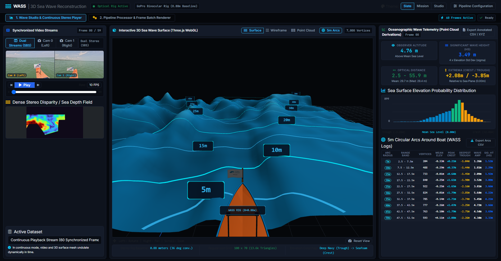
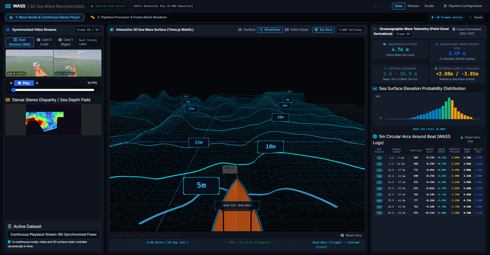
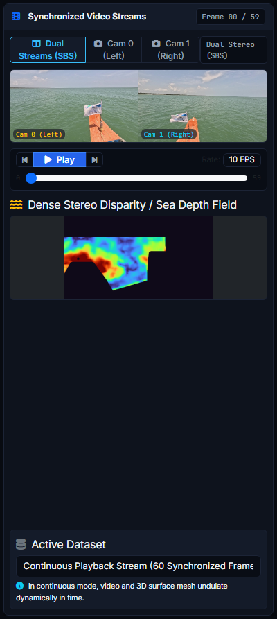
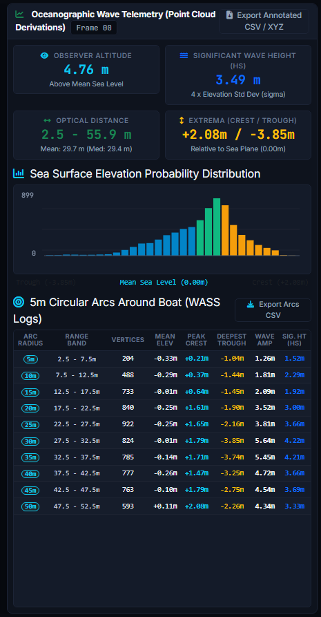
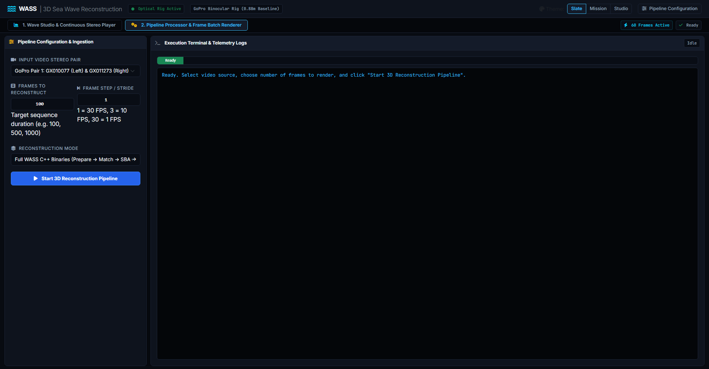

# WASS - 3D Ocean Wave Stereophotogrammetry Studio

[](tests/)
[](LICENSE)
[](https://www.python.org/downloads/)
[](https://github.com/features/codespaces)

A high-precision 3D Ocean Wave Stereophotogrammetry Web Studio and processing pipeline based on the **WASS (Waves Acquisition Stereo System)** methodology. The system ingests calibrated binocular video streams (at up to native 30 FPS), computes dense disparity and 3D slant range ocean surface elevation, drapes concentric nautical radar range arcs, extracts 200 Hz GoPro HERO binocular IMU telemetry, and performs sub-millisecond hydroacoustic audio cross-correlation auto-sync.

---

## 1. Web Studio Cockpit Overview

The primary dashboard provides a unified control room for 3D sea wave visualization, binocular video review, and quantitative oceanographic telemetry.

<p align="center">
  
</p>
<p align="center">
  <em>Figure 1: Full Cockpit Overview — Synchronized SBS video stream, 3D wave mesh with Kerala boat bow and concentric 5m nautical arcs, elevation probability histogram, and live oceanographic telemetry.</em><br/>
  <a href="./docs/images/01_wave_studio_cockpit.png">[docs/images/01_wave_studio_cockpit.png]</a>
</p>

### Key Display Elements
* **Dual Synchronized Video Streams (Left):** Real-time synchronized playback of left (`Cam 0`) and right (`Cam 1`) camera views alongside the dense disparity depth field.
* **Interactive 3D Sea Wave Viewport (Center):** 7,000-vertex regularized surface mesh ($100 \times 70$ grid, 13,662 triangles) with the physical Kerala orange boat bow and 10 dynamic nautical radar range arcs.
* **Oceanographic Wave Telemetry & Distribution (Right):** Live Significant Wave Height ($H_s$), extrema crest/trough altitudes, elevation probability density histogram, and distance-stratified 5m arc breakdown table.
* **GoPro HERO IMU Cockpit:** Synchronized 6-axis vessel attitude ($Roll, Pitch, Yaw$ rates and $3D$ accelerations) mapped to every video frame.

---

## 2. 3D Sea Wave Mesh & Nautical Radar Arcs

The 3D WebGL viewport models both the ocean wave field and the physical observing vessel with geometric precision.

<p align="center">
  
</p>
<p align="center">
  <em>Figure 2: Topological Wireframe Mode — 7,000 vertices (13,662 triangles) with 10 dynamically draped 5m circular range arcs and staggered azimuth labels.</em><br/>
  <a href="./docs/images/04_render_mode_wireframe.png">[docs/images/04_render_mode_wireframe.png]</a>
</p>

### Physical & Spatial Features
* **Kerala Orange Vessel Bow:** Faithfully models a traditional wooden fishing vessel bow ($Y \in [-1.2, 4.0]\,\text{m}$) rendered in marine orange (`#ea580c`) with blue gunwales, forward stem post, and research vessel flag.
* **Bilateral Water Channels:** Water elevation begins at $Y = 2.50\,\text{m}$, allowing sea waves to flow naturally on both sides of the hull with $24.45\,\text{m}$ port and $14.45\,\text{m}$ starboard clearance.
* **10 Concentric 5m Nautical Radar Arcs:** Radiating from the vessel optical origin $(0, 0, 0)$ at radii $5\,\text{m}, 10\,\text{m}, 15\,\text{m}, \dots, 50\,\text{m}$.
* **1.000m Bow Clearance:** The vessel prow apex is situated at $Y = 4.000\,\text{m}$, providing exactly $1.000\,\text{m}$ physical clearance to the 5m radar arc apex at $Y = 5.000\,\text{m}$.
* **Surface-Draped Radar Ribbons:** Each 17cm-wide nautical arc is dynamically draped directly onto the undulating sea mesh surface at $Z_{\text{wave}} + 0.15\,\text{m}$ via bilinear interpolation.
* **Staggered Azimuth Labels:** Arc distance tags are staggered along $-14^\circ$ and $+14^\circ$ azimuths (with the 5m label offset to $-22^\circ$) to eliminate visual occlusion.

### 3D Viewport Controls
* **Render Modes:** Toggle between **Surface** (colored by elevation from Deep Navy to Seafoam Crest), **Wireframe** (topological triangle grid), and **Point Cloud** (individual 3D vertices).
* **5m Arcs Toggle:** Quickly show or hide the 10 circular nautical range rings with the **5m Arcs** toolbar button.
* **Mouse Navigation:**
  * **Left-Click + Drag:** Orbit camera around focus target $(0, 16, 0)$.
  * **Right-Click + Drag:** Pan camera laterally and vertically.
  * **Scroll Wheel:** Zoom into sea troughs or pull back for macro ocean survey.
  * **Reset View Button:** Restores default vantage point $(X=0\,\text{m}, Y=-6.5\,\text{m}, Z=6.0\,\text{m})$.

---

## 3. Synchronized Video Playback & Framerate Fidelity

The left column contains stereoscopic video stream synchronization and disparity inspection tools.

<p align="center">
  
</p>
<p align="center">
  <em>Figure 3: Synchronized Stereoscopic Stream Selector — Dual camera playback controls, timeline scrubber, and dense disparity field map.</em><br/>
  <a href="./docs/images/05_video_disparity_playback.png">[docs/images/05_video_disparity_playback.png]</a>
</p>

### Playback & Framerate Controls
* **Stream Selector Tabs:**
  * **Dual Streams (SBS):** Side-by-side view showing left and right video streams simultaneously.
  * **Cam 0 (Left):** Primary optical camera view.
  * **Cam 1 (Right):** Secondary stereo camera view.
  * **Dual Stereo (SBS):** Side-by-side composite stream.
* **Playback Controls:** Play / Pause toggle, Previous Frame, Next Frame, and selectable playback speed (`5`, `10`, `15`, `24`, `30`, `60` FPS).
* **Native 30 FPS Fidelity (`step = 1`):**
  * Temporal Nyquist cutoff: $f_{\text{Nyquist}} = 15\,\text{Hz}$ at 30 FPS (vs. $5\,\text{Hz}$ at 10 FPS).
  * Retains 100% of optical camera exposures, resolving steep breaking crests, micro-capillary waves, and turbulent foam transitions without temporal aliasing.
  * Dynamic sequence framerate handling automatically adapts telemetry timestamps and IMU interpolation to the video's native capture rate.
* **Dense Stereo Disparity Viewer:** Color-mapped disparity map ($u \in [40, 670]$ cone) showing pixel parallax across the stereo overlap region.

---

## 4. GoPro HERO Binocular Dual-IMU & Audio Synchronization

The platform includes full support for extracting, synchronizing, and fusing high-frequency IMU telemetry and hydroacoustic audio from binocular GoPro HERO rigs.

### 200 Hz ICM-20689 IMU Extraction
* **Direct GPMF Telemetry Decoding:** Automatically extracts binary GPMF telemetry (`ACCL` accelerometer and `GYRO` gyroscope streams) from native MP4 containers (`GX010077.MP4`, `GX011273.MP4`).
* **Sub-Millisecond Spline Interpolation:** Re-samples 200 Hz IMU records ($\Delta t = 5\,\text{ms}$) to match physical camera shutter timestamps using cubic spline interpolation.
* **Multi-Camera Feed Switching:** Toggle between binocular fused stereo (`pair1_stereo`, `pair2_stereo`) or individual feeds (`GX010077.MP4`, `GX011273.MP4`) via the UI or REST API.

### Hydroacoustic Audio & Shutter Auto-Sync
* **48 kHz Audio Cross-Correlation:** Analyzes audio tracks between dual cameras using generalized cross-correlation phase transform (GCC-PHAT) to calculate shutter lag down to sub-millisecond precision.
* **Calibrated GoPro Lead (+23.60 s):** Detects physical trigger offset (+23.60 seconds / 1,132,800 audio samples lead on Cam 1).
* **Hardware Ingestion Fast-Forward:** Video extraction automatically advances the leading camera during ingestion via `cap.grab()`, synchronizing optical shutter frames before stereo rectification.

---

## 5. Oceanographic Telemetry & Data Export

The right column provides quantitative wave telemetry and multiple export options for single frames and full sequences.

<p align="center">
  
</p>
<p align="center">
  <em>Figure 4: Quantitative Telemetry Panel — 10-bin distance-stratified 5m arc telemetry table, elevation probability distribution, and RFC 4180 CSV export triggers.</em><br/>
  <a href="./docs/images/03_data_export_telemetry.png">[docs/images/03_data_export_telemetry.png]</a>
</p>

### Live Telemetry Metrics
* **Observer Altitude:** Metric camera height $H_{\text{cam}} = 4.76\,\text{m}$ above Mean Sea Level.
* **Significant Wave Height ($H_s$):** Computed oceanographically as $H_s = 4 \cdot \sigma_\eta$.
* **Optical Distance Span:** Minimum and maximum optical range (typically $2.5\,\text{m} \to 55.9\,\text{m}$, mean $\approx 29.7\,\text{m}$).
* **Elevation Extrema:** Peak crest elevation ($+2.08\,\text{m}$) and deepest trough ($-3.85\,\text{m}$) relative to Mean Sea Level ($0.00\,\text{m}$).
* **Elevation Probability Distribution:** 30-bin histogram displaying probability density function of wave heights.

---

### Export Formats (RFC 4180 Compliant with Timestamps & IMU)

All exported CSV formats include synchronized optical frame timestamps and 6-axis IMU vessel attitude:

#### 1. 5m Circular Arcs Summary CSV (`/api/wave_analysis/export_arcs/{frame_id}`)
Summarizes oceanographic wave statistics across all 10 radial distance bands:
```csv
arc_radius_m,range_band,vertex_count,mean_elevation_m,peak_crest_m,deepest_trough_m,wave_amplitude_m,significant_wave_height_Hs_m,elevation_std_sigma_m,azimuth_min_deg,azimuth_max_deg,azimuth_span_deg,timestamp_sec,gyro_x_dps,gyro_y_dps,gyro_z_dps,accel_x_g,accel_y_g,accel_z_g
5.0,2.5 - 7.5m,204,-0.330,0.210,-1.040,1.250,1.520,0.380,-68.5,58.2,126.7,0.0000,-1.89,0.31,1.10,0.993,-0.040,0.119
10.0,7.5 - 12.5m,488,-0.290,0.370,-1.440,1.810,2.290,0.570,-74.1,64.8,138.9,0.0000,-1.89,0.31,1.10,0.993,-0.040,0.119
...
50.0,47.5 - 52.5m,593,0.110,2.080,-2.260,4.340,3.330,0.830,-31.2,19.8,51.0,0.0000,-1.89,0.31,1.10,0.993,-0.040,0.119
```

#### 2. 5m Circumference Points CSV (`/api/wave_analysis/export_circumference/{frame_id}`)
High-resolution 3D wave elevation along the perimeter of the 10 concentric arcs:
```csv
frame_index,timestamp_sec,arc_radius_m,azimuth_deg,x_m,y_m,wave_height_m,distance_from_vessel_m,gyro_x_dps,gyro_y_dps,gyro_z_dps,accel_x_g,accel_y_g,accel_z_g
0,0.0000,5.0,-68.5,-4.65,1.83,-0.120,4.99,-1.89,0.31,1.10,0.993,-0.040,0.119
0,0.0000,5.0,-67.0,-4.61,1.95,-0.115,5.01,-1.89,0.31,1.10,0.993,-0.040,0.119
...
```

#### 3. Annotated 3D Point Cloud CSV (`export_annotated_xyz` / CLI)
Complete $[X, Y, Z]$ spatial coordinates with slant range and elevation from sea level:
```csv
x_camera_m,y_camera_m,z_camera_m,distance_from_observer_m,height_from_sea_level_m,timestamp_sec,gyro_x_dps,gyro_y_dps,gyro_z_dps,accel_x_g,accel_y_g,accel_z_g
-25.0000,2.5000,-0.3120,25.5768,-0.3120,0.0000,-1.89,0.31,1.10,0.993,-0.040,0.119
-24.5960,2.5000,-0.2850,25.1824,-0.2850,0.0000,-1.89,0.31,1.10,0.993,-0.040,0.119
...
```

#### 4. Batch ZIP Export (`/api/wave_analysis/export_all_arcs_zip`)
Downloads all sequence frame CSVs bundled into a single ZIP archive for offline scientific analysis.

---

## 6. Pipeline Processor: Importing & Reconstructing Data

Tab 2 provides the batch processing engine for ingesting raw stereo video footage, setting frame quantities and stride, and triggering 3D stereophotogrammetric reconstruction.

<p align="center">
  
</p>
<p align="center">
  <em>Figure 5: Tab 2 Pipeline Processor — Input stereo video pair selection, frame quantity selector, frame step / stride configuration, and execution terminal.</em><br/>
  <a href="./docs/images/02_pipeline_processor.png">[docs/images/02_pipeline_processor.png]</a>
</p>

### Step-by-Step Reconstruction Guide

1. **Select Tab 2:** Click **2. Pipeline Processor & Frame Batch Renderer** in the top navigation bar.
2. **Choose Input Video Stereo Pair:**
   * **GoPro Pair 1:** Pre-configured calibrated stereo footage (`GX010077` Left $\leftrightarrow$ `GX011273` Right).
   * **GoPro Pair 2:** Alternate calibrated sequence (`GX010078` Left $\leftrightarrow$ `GX011274` Right).
   * **Dual Video Upload:** Upload your own synchronized `Cam 0` and `Cam 1` MP4 video files.
   * **Side-by-Side (SBS) Upload:** Upload a single side-by-side composite stereo MP4 video.
3. **Set the Number of Frames to Reconstruct:**
   * Enter the desired number of frames in the **Frames to Reconstruct** field (e.g. `20`, `60`, `100`, `500`, `1000`).
4. **Set Frame Step / Stride:**
   * Set the extraction stride in the **Frame Step / Stride** field:
     * `1` = Native consecutive frames (processes every frame, 30 FPS).
     * `2` = Alternate frames (every 2nd frame, 15 FPS).
     * `3` = 10 FPS downsampling.
     * `30` = 1 FPS time-lapse sampling.
5. **Select Reconstruction Mode:**
   * **Full WASS C++ Binaries:** Complete pipeline (`wass_prepare` $\to$ `wass_match` $\to$ `wass_autocalibrate` $\to$ `wass_stereo`).
6. **Launch Processing:** Click **Start 3D Reconstruction Pipeline**. Real-time logs and stage progress stream in the **Execution Terminal & Telemetry Logs** panel.

### Command-Line Python Pipeline Execution (CLI)

```bash
# Ingest dual-camera video streams with audio synchronization
python wass_webapp/wass_video_pipeline.py \
    --video0 path/to/cam0_left.mp4 \
    --video1 path/to/cam1_right.mp4 \
    --max-frames 100 \
    --step 1 \
    --work-dir ./pipeline_output

# Ingest Side-by-Side (SBS) composite stereo video
python wass_webapp/wass_video_pipeline.py \
    --video-sbs path/to/stereo_sbs.mp4 \
    --max-frames 100 \
    --step 1 \
    --work-dir ./pipeline_output
```

---

## 7. System Architecture & Directory Layout

```
.
├── .devcontainer/
│   ├── devcontainer.json               # 1-Click GitHub Codespaces configuration
│   └── Dockerfile                      # Devcontainer build specification
├── .github/
│   └── workflows/
│       └── ci.yml                      # Automated CI verification suite
├── docs/
│   ├── DATA_SPECIFICATION.md           # Oceanographic coordinates & mathematical specification
│   └── images/                         # Documentation visual walkthrough screenshots
├── tests/
│   ├── test_wave_math.py               # Unit tests for physical stereo math & 5m arcs
│   ├── test_api_endpoints.py           # Integration tests for FastAPI endpoints & RFC 4180 CSV
│   ├── test_gopro_imu.py               # GoPro ICM-20689 IMU extraction & audio sync tests
│   ├── test_audio_sync.py              # Sub-millisecond hydroacoustic cross-correlation tests
│   ├── test_gopro_profile.py           # GoPro optical profiles & autocalibration XML tests
│   ├── test_adversarial_backend_breaker.py # CLI arguments, corrupted files, and upload bounds
│   ├── test_adversarial_break_e2e.py   # Concurrency locks, path traversal, & fuzzing tests
│   ├── test_security_resilience.py     # Path traversal, upload sanitization, & concurrency
│   └── test_codespaces_e2e.py          # Codespaces configuration & health verification
├── wass_webapp/
│   ├── app.py                          # High-performance FastAPI backend application
│   ├── analyze_wave_xyz.py             # Core oceanographic wave field analyzer & 5m radar arcs
│   ├── audio_sync.py                   # Hydroacoustic audio cross-correlation & shutter sync
│   ├── gopro_imu.py                    # GoPro 200 Hz IMU telemetry parser & feed router
│   ├── gopro_profile.py                # GoPro camera profile registry & calibration builder
│   ├── wass_video_pipeline.py          # Native WASS C++ video ingestion & batch reconstruction
│   ├── static/                         # Vendored Three.js, OrbitControls, Bootstrap
│   ├── templates/
│   │   └── index.html                  # Responsive 3D WebGL cockpit
│   └── workspace/
│       ├── config/                     # WASS camera calibrations & worksession configurations
│       └── sequence/                   # Reconstructed calibrated stereo dataset
├── LICENSE                             # MIT License
├── pyproject.toml                      # Standard Python build configuration & pytest options
├── README.md                           # Web Studio documentation & complete guide
└── requirements.txt                    # Pinned runtime dependencies
```

---

## 8. Quickstart

### Option 1: GitHub Codespaces (1-Click Cloud Launch)
1. Open this repository in **GitHub Codespaces**.
2. Codespaces automatically builds the container and installs dependencies.
3. Start the application:
   ```bash
   python -m uvicorn wass_webapp.app:app --host 0.0.0.0 --port 8080
   ```
4. Click the forwarded port **8080** in the Ports tab to open the 3D Wave Studio.

### Option 2: Local Installation (Linux / macOS / Windows)
1. **Clone the repository:**
   ```bash
   git clone https://github.com/tanay1904/WASS_Web_App.git
   cd WASS_Web_App
   ```

2. **Create a virtual environment:**
   ```bash
   python -m venv venv
   source venv/bin/activate  # On Windows: venv\Scripts\activate
   ```

3. **Install dependencies:**
   ```bash
   pip install -r requirements.txt
   ```

4. **Launch the Web Studio:**
   ```bash
   python wass_webapp/app.py
   ```
   Open your browser at `http://127.0.0.1:8080/`.

---

## 9. REST API Endpoints

| Method | Endpoint | Description |
| :---: | :--- | :--- |
| `GET` | `/` | Web Studio 3D cockpit interface |
| `GET` | `/favicon.ico` | Instant zero-latency SVG wave icon |
| `GET` | `/api/status` | Current pipeline and playback state |
| `GET` | `/api/sequence/meta` | Sequence metadata (frame count, FPS, grid dimensions) |
| `GET` | `/api/sequence/frame/{index}` | Regularized $[X, Y, Z]$ vertices for frame index |
| `GET` | `/api/sequence/all_points` | Pre-cached binary sequence point cloud buffer |
| `GET` | `/api/wave_analysis/{frame_id}` | Oceanographic wave telemetry and 10 concentric 5m radar arcs |
| `GET` | `/api/wave_analysis/export_arcs/{frame_id}` | RFC 4180 CSV export of the 10 circular range arcs (with IMU) |
| `GET` | `/api/wave_analysis/export_circumference/{frame_id}` | RFC 4180 CSV export of arc circumference vertices (with IMU) |
| `GET` | `/api/wave_analysis/export_all_arcs_zip` | Download complete sequence of arc CSVs bundled in a ZIP |
| `GET` | `/api/telemetry/imu` | Retrieve synchronized GoPro HERO 6-axis IMU telemetry |
| `GET` | `/api/telemetry/imu/frame/{frame_id}` | Retrieve IMU attitude and acceleration for a single frame |
| `GET` | `/api/telemetry/imu/csv` | Download raw GoPro IMU telemetry as an RFC 4180 CSV |
| `GET` | `/api/telemetry/imu/feeds` | List all available GoPro camera feeds and stereo pairs |
| `POST`| `/api/telemetry/imu/toggle_audio_sync` | Enable or disable hydroacoustic audio synchronization |
| `POST`| `/api/run` | Triggers stereo video batch reconstruction pipeline |

---

## 10. Running the Automated Test Suite

Run the full automated test suite covering physical stereo mathematics, vessel geometry, 5m circular range rings, GoPro IMU decoding, hydroacoustic audio cross-correlation, adversarial edge cases, security path traversal, and FastAPI endpoints:

```bash
# Run all 176 automated unit, integration, and security tests
python -m pytest -v

# Run GoPro IMU & hydroacoustic audio sync test suite
python -m pytest tests/test_gopro_imu.py tests/test_audio_sync.py -v

# Run physical stereo math and 5m radar arc geometry tests
python -m pytest tests/test_wave_math.py -v

# Run FastAPI endpoint and RFC 4180 CSV export tests
python -m pytest tests/test_api_endpoints.py -v

# Run adversarial fuzzing and breaker suites
python -m pytest tests/test_adversarial_break_e2e.py tests/test_adversarial_backend_breaker.py -v

# Run security resilience (path traversal, upload sanitization, concurrency locks)
python -m pytest tests/test_security_resilience.py -v
```

---

## 11. Complete Python Commands & SDK Reference

### 1. Ingesting Point Clouds & Exporting Telemetry via Python SDK
```python
from wass_webapp.analyze_wave_xyz import analyze_xyz, export_annotated_xyz, export_circular_arcs_circumference_csv

# Analyze point cloud, compute 5m concentric radar arcs, and extract wave metrics
stats, pts, distances, elevations = analyze_xyz("wass_webapp/workspace/sequence/pointcloud_000.xyz")
print(f"Significant Wave Height (Hs): {stats['wave_parameters']['significant_wave_height_Hs_m']} m")
print(f"Peak Crest Elevation: {stats['wave_parameters']['crest_elevation_max_m']} m")

# Export annotated dataset [X, Y, Z, distance, MSL_elevation, timestamp_sec, gyro, accel]
export_annotated_xyz(pts, distances, elevations, "annotated_wave_points.csv", frame_index=0, timestamp_sec=0.0)

# Export circumference vertices along the 10 radar arcs
export_circular_arcs_circumference_csv(pts, elevations, "circumference_points.csv", frame_index=0, timestamp_sec=0.0)
```

### 2. Querying Telemetry & Downloading Datasets Programmatically
```python
import requests
import pandas as pd

BASE_URL = "http://127.0.0.1:8080"

# 1. Download 5m circular radar arcs CSV with IMU for Frame 0
df_arcs = pd.read_csv(f"{BASE_URL}/api/wave_analysis/export_arcs/sequence_000")
print("5m Radar Arcs Telemetry (Frame 0):")
print(df_arcs[["arc_radius_m", "range_band", "significant_wave_height_Hs_m", "timestamp_sec", "gyro_x_dps", "accel_z_g"]])

# 2. Query synchronized GoPro IMU telemetry with audio sync enabled
imu_resp = requests.get(f"{BASE_URL}/api/telemetry/imu?audio_sync=true").json()
print(f"IMU Device: {imu_resp['device']}, Sample Rate: {imu_resp['sample_rate_hz']} Hz")
print(f"Audio Offset: {imu_resp['audio_sync']['offset_ms']} ms ({imu_resp['audio_sync']['status']})")

# 3. Retrieve complete sequence point cloud vertices
all_points = requests.get(f"{BASE_URL}/api/sequence/all_points").json()
print(f"Retrieved 3D mesh points for {len(all_points)} frames.")
```

---

## 12. Scientific Background & References

* **WASS (Waves Acquisition Stereo System):** Developed by F. Bergamasco, A. Cavallaro, and A. Benetazzo.
* **Stereo Formulation:**
  * Benetazzo, A. (2006). *Measurements of short water waves using stereo photography.* Coastal Engineering, 53(12), 1013-1027.
  * Bergamasco, F., Torsello, A., Sclavo, M., Barbariol, F., & Benetazzo, A. (2017). *WASS: An open-source pipeline for 3D stereo reconstruction of ocean waves.* Computers & Geosciences, 107, 28-38.

---

## License

This project is licensed under the MIT License - see the [LICENSE](LICENSE) file for details.
