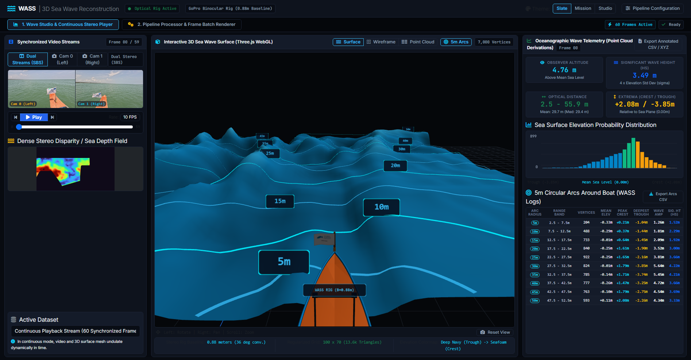
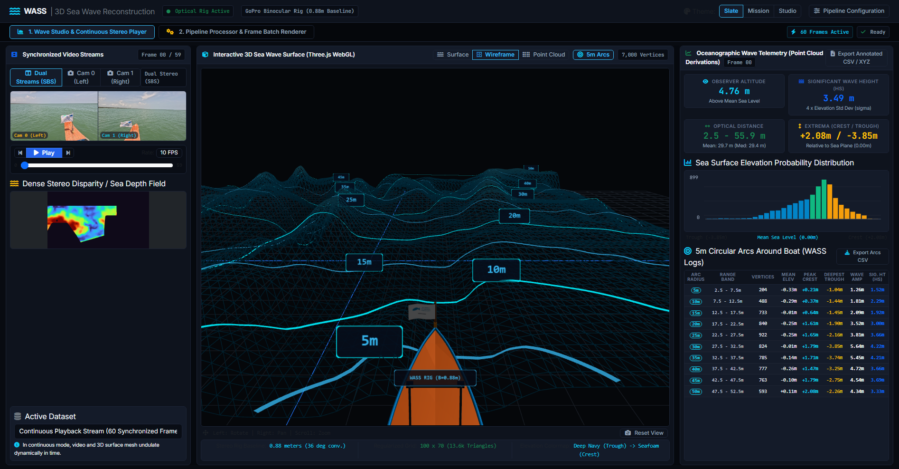
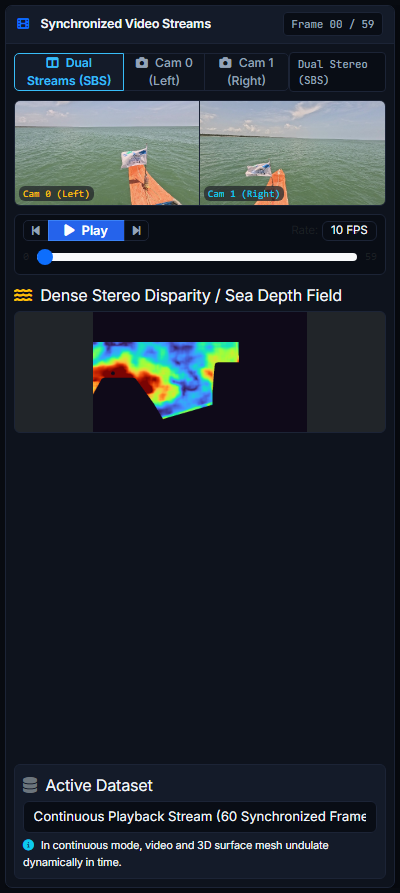
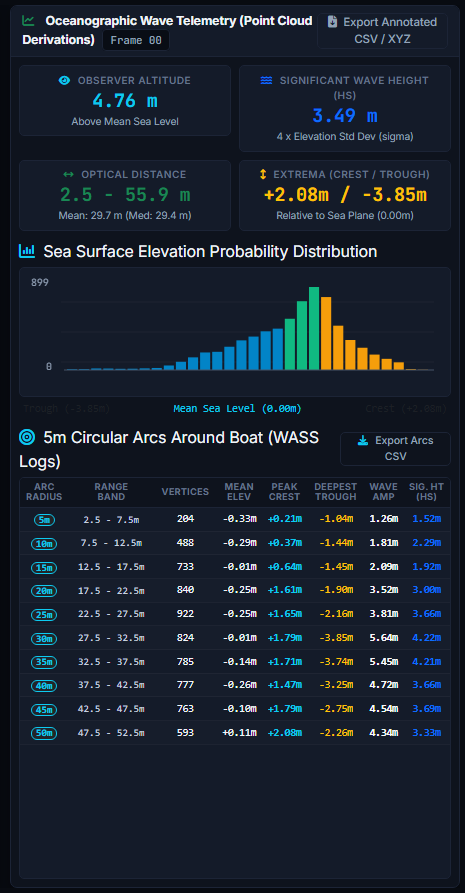
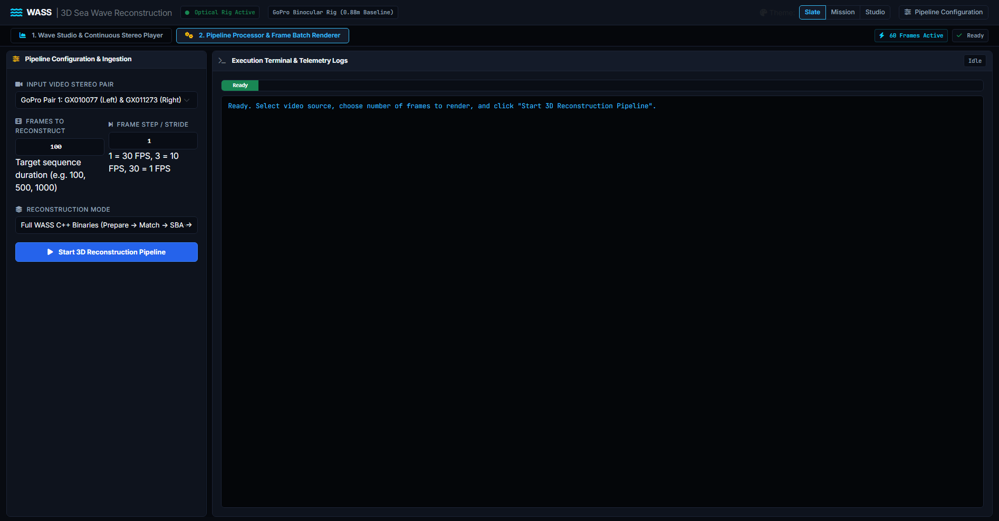

# WASS - 3D Ocean Wave Stereophotogrammetry Studio

[](tests/)
[](LICENSE)
[](https://www.python.org/downloads/)
[](https://github.com/features/codespaces)

A real-time, interactive 3D Ocean Wave Stereophotogrammetry Web Studio and processing pipeline based on the **WASS (Waves Acquisition Stereo System)** methodology. The system ingests calibrated binocular video streams, computes dense disparity and 3D slant range ocean surface elevation, drapes concentric nautical radar range arcs, and visualizes dynamic wave kinematics at up to 10 FPS.

---

## 1. Web Studio Cockpit Overview

The primary dashboard provides a unified, zero-latency control room for 3D sea wave visualization, binocular video review, and quantitative oceanographic telemetry.

<p align="center">
  
</p>
<p align="center">
  <em>Figure 1: Full Cockpit Overview — Real-time synchronized SBS video stream, 3D wave mesh with Kerala boat bow and concentric 5m nautical arcs, elevation probability histogram, and live oceanographic telemetry.</em><br/>
  <a href="file:///c:/Users/tanay/predicttion/docs/images/01_wave_studio_cockpit.png">[Open Full-Resolution 1080p PNG]</a> &bull; <a href="./docs/images/01_wave_studio_cockpit.png">[docs/images/01_wave_studio_cockpit.png]</a>
</p>

### Key Display Elements
* **Dual Synchronized Video Streams (Left):** Real-time synchronized playback of left (`Cam 0`) and right (`Cam 1`) camera views alongside the dense disparity depth field.
* **Interactive 3D Sea Wave Viewport (Center):** 7,000-vertex regularized surface mesh ($100 \times 70$ grid, 13,662 triangles) with the physical Kerala orange boat bow and 10 dynamic nautical radar range arcs.
* **Oceanographic Wave Telemetry & Distribution (Right):** Live Significant Wave Height ($H_s$), extrema crest/trough altitudes, elevation probability density histogram, and distance-stratified 5m arc breakdown table.

---

## 2. 3D Sea Wave Mesh & Nautical Radar Arcs

The 3D WebGL viewport models both the ocean wave field and the physical observing vessel with geometric precision.

<p align="center">
  
</p>
<p align="center">
  <em>Figure 2: Topological Wireframe Mode — 7,000 vertices (13,662 triangles) with 10 dynamically draped 5m circular range arcs and staggered azimuth labels.</em><br/>
  <a href="file:///c:/Users/tanay/predicttion/docs/images/04_render_mode_wireframe.png">[Open Full-Resolution 1080p PNG]</a> &bull; <a href="./docs/images/04_render_mode_wireframe.png">[docs/images/04_render_mode_wireframe.png]</a>
</p>

### Physical & Spatial Features
* **Kerala Orange Vessel Bow:** Faithfully models a traditional wooden fishing vessel bow ($Y \in [-1.2, 4.0]\,\text{m}$) rendered in marine orange (`#ea580c`) with blue gunwales, forward stem post, and research vessel flag.
* **Bilateral Water Channels:** Water elevation begins at $Y = 2.50\,\text{m}$, allowing sea waves to flow naturally on both sides of the hull with $24.45\,\text{m}$ port and $14.45\,\text{m}$ starboard clearance.
* **10 Concentric 5m Nautical Radar Arcs:** Radiating from the vessel optical origin $(0, 0, 0)$ at radii $5\,\text{m}, 10\,\text{m}, 15\,\text{m}, \dots, 50\,\text{m}$.
* **1.000m Bow Clearance:** The vessel prow apex is situated at $Y = 4.000\,\text{m}$, providing exactly $1.000\,\text{m}$ physical clearance to the 5m radar arc apex at $Y = 5.000\,\text{m}$.
* **Surface-Draped Radar Ribbons:** Each 17cm-wide nautical arc is dynamically draped directly onto the undulating sea mesh surface at $Z_{\text{wave}} + 0.15\,\text{m}$ via bilinear interpolation.
* **Staggered Azimuth Labels:** Arc distance tags are staggered along $-14^\circ$ and $+14^\circ$ azimuths (with the 5m label offset to $-22^\circ$) to eliminate visual occlusion.

### 3D Viewport Controls
* **Render Modes:** Toggle between **Surface** (colored by elevation from Deep Navy to Seafoam Crest), **Wireframe** (topological triangle grid), and **Point Cloud** (individual 3D vertices).
* **5m Arcs Toggle:** Quickly show or hide the 10 circular nautical range rings with the **5m Arcs** toolbar button.
* **Mouse Navigation:**
  * **Left-Click + Drag:** Orbit camera around focus target $(0, 16, 0)$.
  * **Right-Click + Drag:** Pan camera laterally and vertically.
  * **Scroll Wheel:** Zoom into sea troughs or pull back for macro ocean survey.
  * **Reset View Button:** Restores default vantage point $(X=0\,\text{m}, Y=-6.5\,\text{m}, Z=6.0\,\text{m})$.

---

## 3. Synchronized Video Playback & Disparity Field

The left column contains the stereoscopic video stream synchronization and disparity inspection tools.

<p align="center">
  
</p>
<p align="center">
  <em>Figure 3: Synchronized Stereoscopic Stream Selector — Dual camera playback controls, 60-frame scrub timeline, and dense disparity field map.</em><br/>
  <a href="file:///c:/Users/tanay/predicttion/docs/images/05_video_disparity_playback.png">[Open Full-Resolution 1080p PNG]</a> &bull; <a href="./docs/images/05_video_disparity_playback.png">[docs/images/05_video_disparity_playback.png]</a>
</p>

### Playback Controls
* **Stream Selector Tabs:**
  * **Dual Streams (SBS):** Side-by-side view showing left and right video streams simultaneously.
  * **Cam 0 (Left):** Primary optical camera view.
  * **Cam 1 (Right):** Secondary stereo camera view.
  * **Dual Stereo (SBS):** Side-by-side composite stream.
* **Playback Controls:** Play / Pause toggle, Previous Frame, Next Frame, and 10 FPS playback rate indicator.
* **Interactive Timeline Slider:** Scrub through all 60 synchronized frames with instantaneous 3D mesh updating.
* **Dense Stereo Disparity Viewer:** Color-mapped disparity map ($u \in [40, 670]$ cone) showing pixel parallax across the stereo overlap region.

---

## 4. Oceanographic Telemetry & Data Export

The right column provides quantitative oceanographic wave telemetry and multiple export options for individual frames and full sequences.

<p align="center">
  
</p>
<p align="center">
  <em>Figure 4: Quantitative Telemetry Panel — 10-bin distance-stratified 5m arc telemetry table, elevation probability distribution, and RFC 4180 CSV export triggers.</em><br/>
  <a href="file:///c:/Users/tanay/predicttion/docs/images/03_data_export_telemetry.png">[Open Full-Resolution 1080p PNG]</a> &bull; <a href="./docs/images/03_data_export_telemetry.png">[docs/images/03_data_export_telemetry.png]</a>
</p>

### Live Telemetry Metrics
* **Observer Altitude:** Metric camera height $H_{\text{cam}} = 4.76\,\text{m}$ above Mean Sea Level.
* **Significant Wave Height ($H_s$):** Computed oceanographically as $H_s = 4 \cdot \sigma_\eta$.
* **Optical Distance Span:** Minimum and maximum optical range (typically $2.5\,\text{m} \to 55.9\,\text{m}$, mean $\approx 29.7\,\text{m}$).
* **Elevation Extrema:** Peak crest elevation ($+2.08\,\text{m}$) and deepest trough ($-3.85\,\text{m}$) relative to Mean Sea Level ($0.00\,\text{m}$).
* **Elevation Probability Distribution:** 30-bin histogram displaying probability density function of wave heights.
* **5m Circular Arcs Telemetry Table:** Complete breakdown across all 10 range bands listing vertex count, mean elevation, crest height, trough depth, wave amplitude, significant wave height ($H_s$), and azimuth span.

---

### How to Export Data

#### 1. Exporting 5m Circular Arcs CSV (Single Frame)
Click the **Export Arcs CSV** button in the header of the 5m Arcs table (or query `/api/wave_analysis/export_arcs/{frame_id}` directly). This downloads an **RFC 4180** compliant CSV with the following 12 columns:
```csv
arc_radius_m,range_band,vertex_count,mean_elevation_m,peak_crest_m,deepest_trough_m,wave_amplitude_m,significant_wave_height_Hs_m,elevation_std_sigma_m,azimuth_min_deg,azimuth_max_deg,azimuth_span_deg
5.0,2.5 - 7.5m,204,-0.330,0.210,-1.040,1.250,1.520,0.380,-68.5,58.2,126.7
10.0,7.5 - 12.5m,488,-0.290,0.370,-1.440,1.810,2.290,0.570,-74.1,64.8,138.9
...
50.0,47.5 - 52.5m,593,0.110,2.080,-2.260,4.340,3.330,0.830,-31.2,19.8,51.0
```

#### 2. Exporting Annotated 3D Point Cloud (CSV / XYZ)
Click the **Export Annotated CSV / XYZ** button at the top of the telemetry panel. This downloads the complete $[X, Y, Z]$ vertex cloud along with computed distance from observer and elevation relative to Mean Sea Level:
```csv
x_camera_m,y_camera_m,z_camera_m,distance_from_observer_m,height_from_sea_level_m
-25.0000,2.5000,-0.3120,25.5768,-0.3120
-24.5960,2.5000,-0.2850,25.1824,-0.2850
...
```

#### 3. Exporting Full-Sequence Batch Data (All Frames)
To retrieve the entire reconstructed dataset across all 60 frames programmatically:
* **All 3D Points:** `GET /api/sequence/all_points` returns a pre-serialized JSON mapping each frame index to its 7,000 vertices $[X, Y, Z]$.
* **All Wave Telemetry:** `GET /api/sequence/all_analysis` returns the complete 60-frame time series of wave statistics and 10-bin arc telemetry.
* **Command-Line Batch Extraction:** Retrieve arc telemetry directly via curl or Python API client:
  ```bash
  curl -O http://127.0.0.1:8080/api/wave_analysis/export_arcs/sequence_000
  ```

#### 4. Python API Script: Downloading Single-Frame & Full-Sequence Data
You can download telemetry, arc breakdowns, and point clouds programmatically using Python:

```python
import requests
import pandas as pd

BASE_URL = "http://127.0.0.1:8080"

# 1. Download 5m circular radar arcs CSV for Frame 0 (RFC 4180 format)
csv_url = f"{BASE_URL}/api/wave_analysis/export_arcs/sequence_000"
df_arcs = pd.read_csv(csv_url)
print("5m Radar Arcs Telemetry (Frame 0):")
print(df_arcs[["arc_radius_m", "range_band", "significant_wave_height_Hs_m", "peak_crest_m", "deepest_trough_m"]])

# 2. Retrieve complete 60-frame time series of wave telemetry
analysis_resp = requests.get(f"{BASE_URL}/api/sequence/all_analysis")
all_analysis = analysis_resp.json()
print(f"Retrieved oceanographic time series across {len(all_analysis)} frames.")

# 3. Retrieve pre-cached 3D point cloud vertices (7,000 vertices per frame)
points_resp = requests.get(f"{BASE_URL}/api/sequence/all_points")
all_points = points_resp.json()
print(f"Retrieved 3D surface vertices for {len(all_points)} frames.")
```

#### 5. Standalone Point Cloud (.xyz) Analysis via Python
Use `wass_webapp/analyze_wave_xyz.py` to analyze custom 3D point clouds, compute 5m concentric radar arcs, and export annotated datasets:

```bash
# Analyze benchmark point cloud and export annotated CSV with distance and MSL height
python wass_webapp/analyze_wave_xyz.py wass_webapp/workspace/sequence/pointcloud_000.xyz --export-csv annotated_points_000.csv
```

Programmatic usage inside custom Python scripts:
```python
from wass_webapp.analyze_wave_xyz import analyze_xyz, export_annotated_xyz

# Ingest point cloud and compute wave statistics + 5m radar arcs
stats, pts, distances, elevations = analyze_xyz("wass_webapp/workspace/sequence/pointcloud_000.xyz")

print(f"Significant Wave Height (Hs): {stats['wave_parameters']['significant_wave_height_Hs_m']} m")
print(f"Peak Wave Crest: {stats['wave_parameters']['crest_elevation_max_m']} m")
print(f"Deepest Wave Trough: {stats['wave_parameters']['trough_depth_min_m']} m")

# Export annotated dataset [X, Y, Z, distance, MSL_elevation]
export_annotated_xyz(pts, distances, elevations, "annotated_wave_points.csv")
```

---

## 5. Pipeline Processor: Importing & Reconstructing Data

Tab 2 provides the batch processing engine for ingesting raw stereo video footage, setting frame quantities and stride, and triggering 3D stereophotogrammetric reconstruction.

<p align="center">
  
</p>
<p align="center">
  <em>Figure 5: Tab 2 Pipeline Processor — Input stereo video pair selection, frame quantity selector (e.g. 60 frames), frame step / stride configuration, and real-time execution terminal.</em><br/>
  <a href="file:///c:/Users/tanay/predicttion/docs/images/02_pipeline_processor.png">[Open Full-Resolution 1080p PNG]</a> &bull; <a href="./docs/images/02_pipeline_processor.png">[docs/images/02_pipeline_processor.png]</a>
</p>

### Step-by-Step Reconstruction Guide

1. **Select Tab 2:** Click **2. Pipeline Processor & Frame Batch Renderer** in the top navigation bar.
2. **Choose Input Video Stereo Pair:**
   * **GoPro Pair 1:** Pre-configured calibrated stereo footage (`GX010077` Left $\leftrightarrow$ `GX011273` Right).
   * **GoPro Pair 2:** Alternate calibrated sequence (`GX010078` Left $\leftrightarrow$ `GX011274` Right).
   * **Dual Video Upload:** Upload your own synchronized `Cam 0` and `Cam 1` MP4 video files.
   * **Side-by-Side (SBS) Upload:** Upload a single side-by-side composite stereo MP4 video.
3. **Set the Number of Frames to Reconstruct:**
   * Enter the desired number of frames in the **Frames to Reconstruct** field (e.g. `20`, `60`, `100`, `500`, `1000`).
4. **Set Frame Step / Stride:**
   * Set the extraction stride in the **Frame Step / Stride** field:
     * `1` = Consecutive frames (processes every frame, 30 FPS).
     * `2` = Alternate frames (every 2nd frame).
     * `3` = 10 FPS downsampling (standard for ocean wave temporal analysis).
     * `30` = 1 FPS time-lapse sampling.
5. **Select Reconstruction Mode:**
   * **Full WASS C++ Binaries:** Complete pipeline (`wass_prepare` $\to$ `wass_match` $\to$ `wass_autocalibrate` $\to$ `wass_stereo`).
   * **Regularized Surface Grid:** Fast metric triangulation producing a $100 \times 70$ surface mesh.
6. **Launch Processing:** Click **Start 3D Reconstruction Pipeline**. Real-time logs and stage progress will stream in the **Execution Terminal & Telemetry Logs** panel.

### Command-Line Python Pipeline Execution (CLI)

You can run the full WASS stereophotogrammetric video processing pipeline directly from your terminal using `wass_webapp/wass_video_pipeline.py` without opening the browser.

#### Option A: Ingest Calibrated Dual-Camera Video Streams (Cam 0 & Cam 1)
```bash
python wass_webapp/wass_video_pipeline.py \
    --video0 path/to/cam0_left.mp4 \
    --video1 path/to/cam1_right.mp4 \
    --max-frames 60 \
    --step 3 \
    --work-dir ./pipeline_output
```

#### Option B: Ingest Side-by-Side (SBS) Composite Stereo Video
```bash
python wass_webapp/wass_video_pipeline.py \
    --video-sbs path/to/stereo_sbs.mp4 \
    --max-frames 100 \
    --step 1 \
    --work-dir ./pipeline_output
```

#### CLI Parameter Reference for `wass_webapp/wass_video_pipeline.py`
| Argument | Type | Default | Description |
| :--- | :---: | :---: | :--- |
| `--video0` | `str` | `None` | Path to primary left camera video file (`Cam 0`) |
| `--video1` | `str` | `None` | Path to secondary right camera video file (`Cam 1`) |
| `--video-sbs` | `str` | `None` | Path to single Side-by-Side composite stereo video |
| `--max-frames`| `int` | `10` | Maximum number of frames to extract and reconstruct |
| `--step` | `int` | `1` | Frame extraction stride (`1` = 30 FPS, `3` = 10 FPS, `30` = 1 FPS) |
| `--work-dir` | `str` | `./scratch/...` | Working directory for intermediate frames and outputs |
| `--calib-dir` | `str` | `None` | Directory containing custom camera calibration XML files |

---

## 6. System Architecture & Directory Layout

```
.
├── .devcontainer/
│   └── devcontainer.json               # GitHub Codespaces container specification
├── .devcontainer/
│   └── devcontainer.json               # 1-Click GitHub Codespaces configuration
├── .github/
│   └── workflows/
│       └── ci.yml                      # Automated CI verification suite (Python 3.10, 3.11, 3.12)
├── docs/
│   ├── DATA_SPECIFICATION.md           # Oceanographic coordinates & mathematical specification
│   └── images/                         # Documentation visual walkthrough screenshots
├── tests/
│   ├── test_wave_math.py               # Unit tests for physical stereo math & 5m arcs
│   ├── test_api_endpoints.py           # Integration tests for FastAPI endpoints & RFC 4180 CSV
│   ├── test_adversarial_math.py        # Adversarial fuzzing for SVD, NaNs, Infs, & collinearity
│   └── test_security_resilience.py     # Path traversal, upload sanitization, & concurrency tests
├── wass_webapp/
│   ├── app.py                          # High-performance FastAPI backend application
│   ├── analyze_wave_xyz.py             # Core oceanographic wave field analyzer & 5m radar arcs
│   ├── wass_video_pipeline.py          # Stereo ingestion & calibration pipeline
│   ├── static/
│   │   ├── vendor/                     # 100% offline Three.js, OrbitControls, Bootstrap
│   │   └── webfonts/                   # Vendored FontAwesome webfonts
│   ├── templates/
│   │   └── index.html                  # Responsive 3D WebGL cockpit
│   └── workspace/
│       ├── config/                     # WASS camera calibrations & worksession configurations
│       └── sequence/                   # Benchmark 60-frame calibrated stereo dataset
├── .gitattributes                      # Git LFS & line ending normalization
├── .gitignore                          # Strict file exclusion rules
├── LICENSE                             # MIT License
├── pyproject.toml                      # Standard Python build configuration & pytest options
├── README.md                           # Web Studio documentation & complete guide
└── requirements.txt                    # Pinned runtime dependencies
```

---

## 7. Quickstart

### Option 1: GitHub Codespaces (1-Click Cloud Launch)
1. Open this repository in **GitHub Codespaces**.
2. Codespaces automatically builds the Python 3.10 container and installs dependencies.
3. Start the application:
   ```bash
   python -m uvicorn wass_webapp.app:app --host 0.0.0.0 --port 8080
   ```
4. Click the forwarded port **8080** in the Ports tab to open the 3D Wave Studio.

### Option 2: Local Installation (Windows / Linux / macOS)
1. **Clone the repository:**
   ```bash
   git clone https://github.com/tanay1904/WASS_Web_App.git
   cd WASS_Web_App
   ```

2. **Create a virtual environment:**
   ```bash
   python -m venv venv
   source venv/bin/activate  # On Windows: venv\Scripts\activate
   ```

3. **Install dependencies:**
   ```bash
   pip install -r requirements.txt
   ```

4. **Launch the Web Studio:**
   * **Option A: Direct Python Script:**
     ```bash
     python wass_webapp/app.py
     ```
   * **Option B: Uvicorn Server Module:**
     ```bash
     python -m uvicorn wass_webapp.app:app --host 0.0.0.0 --port 8080
     ```
   * **Option C: Development Mode with Live Auto-Reload:**
     ```bash
     python -m uvicorn wass_webapp.app:app --host 0.0.0.0 --port 8080 --reload
     ```
   Open your browser at `http://127.0.0.1:8080/`.

   * **Option D: Verify Backend Server Health (One-Liner):**
     ```bash
     python -c "import urllib.request, json; print(json.loads(urllib.request.urlopen('http://127.0.0.1:8080/api/status').read()))"
     ```

---

## 8. REST API Endpoints

| Method | Endpoint | Description |
| :---: | :--- | :--- |
| `GET` | `/` | Web Studio 3D cockpit interface |
| `GET` | `/favicon.ico` | Instant zero-latency SVG wave icon |
| `GET` | `/api/status` | Current pipeline and playback state |
| `GET` | `/api/sequence/meta` | Sequence metadata (frame count, FPS, grid dimensions) |
| `GET` | `/api/sequence/frame/{index}` | 7,000 regularized $[X, Y, Z]$ vertices for frame index |
| `GET` | `/api/sequence/all_points` | Pre-cached binary sequence point cloud buffer |
| `GET` | `/api/wave_analysis/{frame_id}` | Oceanographic wave telemetry and 10 concentric 5m radar arcs |
| `GET` | `/api/wave_analysis/export_arcs/{frame_id}` | RFC 4180 compliant CSV export of the 10 circular range arcs |
| `POST` | `/api/run` | Triggers stereo video batch reconstruction pipeline |

---

## 9. Running the Automated Test Suite

Run the full automated test suite covering physical stereo mathematics, vessel geometry, 5m circular range rings, adversarial edge cases, security path traversal, and FastAPI endpoints:

```bash
# Run all 28 unit, integration, and security resilience tests
python -m pytest -v

# Run physical stereo math and 5m radar arc geometry tests only
python -m pytest tests/test_wave_math.py -v

# Run FastAPI endpoint, sequence, and RFC 4180 CSV export tests only
python -m pytest tests/test_api_endpoints.py -v

# Run adversarial math fuzzing (SVD memory bounds, NaNs, Infs, collinearity)
python -m pytest tests/test_adversarial_math.py -v

# Run security resilience (path traversal, upload sanitization, concurrency locks)
python -m pytest tests/test_security_resilience.py -v
```

All 28 test modules evaluate metric scale formulas, bow clearances, 5m range rings, memory allocation boundaries, path sanitization, and API error handling.

---

## 10. Complete Python Commands & SDK Reference

### 1. Starting the Web Studio & Server

* **Direct Script Launch:**
  ```bash
  python wass_webapp/app.py
  ```

* **Production Uvicorn Server:**
  ```bash
  python -m uvicorn wass_webapp.app:app --host 0.0.0.0 --port 8080
  ```

* **Development Mode (Auto-Reload on Code Changes):**
  ```bash
  python -m uvicorn wass_webapp.app:app --host 0.0.0.0 --port 8080 --reload
  ```

* **One-Liner Backend Health Verification:**
  ```bash
  python -c "import urllib.request, json; print(json.loads(urllib.request.urlopen('http://127.0.0.1:8080/api/status').read()))"
  ```

---

### 2. Terminal Pipeline Execution (Stereo Video Ingestion & Reconstruction)

* **Calibrated Dual-Camera Video Streams (Cam 0 & Cam 1):**
  ```bash
  python wass_video_pipeline.py \
      --video0 path/to/cam0_left.mp4 \
      --video1 path/to/cam1_right.mp4 \
      --max-frames 60 \
      --step 3 \
      --work-dir ./pipeline_output
  ```

* **Side-by-Side (SBS) Composite Stereo Video:**
  ```bash
  python wass_video_pipeline.py \
      --video-sbs path/to/stereo_sbs.mp4 \
      --max-frames 100 \
      --step 1 \
      --work-dir ./pipeline_output
  ```

* **CLI Parameter Options:**
  * `--max-frames`: Desired frame quantity to reconstruct (`20`, `60`, `100`, `500`, `1000`).
  * `--step`: Temporal downsampling stride (`1` = 30 FPS, `3` = 10 FPS, `30` = 1 FPS).
  * `--work-dir`: Destination folder for workspaces, `.xyz` point clouds, and disparity maps.

---

### 3. Batch Telemetry & 5m Radar Arc Regeneration

Recalculates dense disparity fields, regularized 3D sea surfaces, and RFC 4180 CSV tables across the entire active sequence:
```bash
python regenerate_5m_arcs.py
```

---

### 4. Standalone Point Cloud (.xyz) Analysis CLI & Python SDK

* **Command-Line Interface:**
  ```bash
  python wass_webapp/analyze_wave_xyz.py wass_webapp/workspace/sequence/pointcloud_000.xyz --export-csv annotated_points_000.csv
  ```

* **Python Programmatic Script:**
  ```python
  from wass_webapp.analyze_wave_xyz import analyze_xyz, export_annotated_xyz

  # Ingest 3D point cloud, fit sea plane, and compute 5m concentric radar arcs
  stats, pts, distances, elevations = analyze_xyz("wass_webapp/workspace/sequence/pointcloud_000.xyz")
  print(f"Significant Wave Height (Hs): {stats['wave_parameters']['significant_wave_height_Hs_m']} m")
  print(f"Peak Crest Elevation: {stats['wave_parameters']['crest_elevation_max_m']} m")

  # Export annotated dataset [X, Y, Z, distance, MSL_elevation]
  export_annotated_xyz(pts, distances, elevations, "annotated_wave_points.csv")
  ```

---

### 4. Python API Client: Downloading Telemetry & Point Clouds

Programmatic access to live Web Studio telemetry using standard Python packages:

```python
import requests
import pandas as pd

BASE_URL = "http://127.0.0.1:8080"

# 1. Download 5m circular radar arcs CSV for Frame 0 (RFC 4180 format)
csv_url = f"{BASE_URL}/api/wave_analysis/export_arcs/sequence_000"
df_arcs = pd.read_csv(csv_url)
print(df_arcs[["arc_radius_m", "range_band", "significant_wave_height_Hs_m", "peak_crest_m"]])

# 2. Retrieve complete 60-frame time series of wave telemetry
all_analysis = requests.get(f"{BASE_URL}/api/sequence/all_analysis").json()
print(f"Retrieved wave analysis for {len(all_analysis)} frames")

# 3. Retrieve 7,000 vertices per frame for all 60 frames (420,000 3D ocean vertices)
all_points = requests.get(f"{BASE_URL}/api/sequence/all_points").json()
print(f"Retrieved 3D mesh points for {len(all_points)} frames")
```

---

### 5. Quick Reference Table

| Task | Command | Description |
| :--- | :--- | :--- |
| **Start Web Studio** | `python wass_webapp/app.py` | Starts FastAPI web server on `http://127.0.0.1:8080` |
| **Start with Uvicorn** | `python -m uvicorn wass_webapp.app:app --host 0.0.0.0 --port 8080` | Production Uvicorn launch |
| **Start Dev Mode** | `python -m uvicorn wass_webapp.app:app --host 0.0.0.0 --port 8080 --reload` | Auto-reloads on file changes |
| **Run Dual-Video Pipeline** | `python wass_webapp/wass_video_pipeline.py --video0 left.mp4 --video1 right.mp4 --max-frames 60 --step 3` | Ingests stereo video pair |
| **Run SBS Video Pipeline** | `python wass_webapp/wass_video_pipeline.py --video-sbs sbs.mp4 --max-frames 100 --step 1` | Ingests Side-by-Side video |
| **Analyze Point Cloud (.xyz)**| `python wass_webapp/analyze_wave_xyz.py wass_webapp/workspace/sequence/pointcloud_000.xyz --export-csv wave_pts.csv` | Analyzes 3D waves & exports CSV |
| **Run Full Test Suite** | `python -m pytest tests/ -v` | Executes all 28 automated tests |
| **Run Wave Math Tests** | `python -m pytest tests/test_wave_math.py -v` | Validates metric formulas & bow clearance |
| **Run API Tests** | `python -m pytest tests/test_api_endpoints.py -v` | Validates endpoints & RFC 4180 CSV |
| **Run Adversarial Math Tests**| `python -m pytest tests/test_adversarial_math.py -v` | Validates SVD, NaNs, Infs, & distance bins |
| **Run Security Tests** | `python -m pytest tests/test_security_resilience.py -v` | Validates traversal, uploads, & concurrency |
| **Install Dependencies** | `pip install -r requirements.txt` | Installs pinned packages |

---

## 11. Scientific Background & References

* **WASS (Waves Acquisition Stereo System):** Developed by F. Bergamasco, A. Cavallaro, and A. Benetazzo.
* **Stereo Formulation:**
  * Benetazzo, A. (2006). *Measurements of short water waves using stereo photography.* Coastal Engineering, 53(12), 1013-1027.
  * Bergamasco, F., Torsello, A., Sclavo, M., Barbariol, F., & Benetazzo, A. (2017). *WASS: An open-source pipeline for 3D stereo reconstruction of ocean waves.* Computers & Geosciences, 107, 28-38.

---

## License

This project is licensed under the MIT License - see the [LICENSE](LICENSE) file for details.
